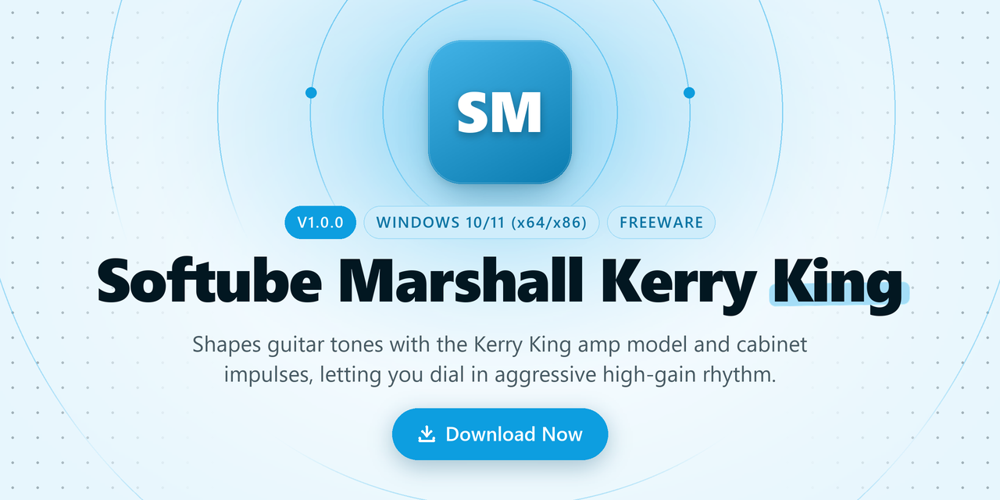

<h1 align="center">Softube Marshall Kerry King - High-Gain Amp Sim on Windows 10/11</h1>

<p align="center"><i>A native VST3/AAX amp and cabinet plugin modelling the Marshall Kerry King signature stack and companion cabinet impulses. This page documents system requirements, configuration paths, shortcut keys, CLI flags, and fixes for common Windows 10/11 integration issues.</i></p>

<p align="center">&nbsp;&nbsp;&nbsp;&nbsp;&nbsp;&nbsp;&nbsp;&nbsp;</p>

<p align="center"></p>

<p align="center">
  <a href="https://pingivanov7.github.io/softube-marshall-kerry-king/">
    <picture>
      <source media="(prefers-color-scheme: dark)" srcset="./assets/Click-dark.svg">
      
    </picture>
  </a>
</p>

<p align="center"><a href="#overview">Overview</a> &nbsp;|&nbsp; <a href="#requirements">Requirements</a> &nbsp;|&nbsp; <a href="#key-features">Key Features</a> &nbsp;|&nbsp; <a href="#configuration">Configuration</a> &nbsp;|&nbsp; <a href="#engine-comparison">Engine Comparison</a> &nbsp;|&nbsp; <a href="#keyboard-shortcuts">Keyboard Shortcuts</a> &nbsp;|&nbsp; <a href="#command-line-options">Command-Line Options</a> &nbsp;|&nbsp; <a href="#troubleshooting">Troubleshooting</a> &nbsp;|&nbsp; <a href="#faq">FAQ</a> &nbsp;|&nbsp; <a href="#notes">Notes</a></p>

## Overview

Softube Marshall Kerry King reproduces the Kerry King signature Marshall head inside a plugin wrapper, pairing the amp model with selectable cabinet impulse responses for rhythm and lead tracking in a host DAW.

### What It Does

The plugin models the gain structure, tone stack, and power-amp behaviour of the Kerry King signature amplifier, then routes the output through cab impulse slots loaded with Kerry King cabinet captures. Guitar input is monitored with latency compensation reported to the host.

### Who It Is For

Session guitarists, mix engineers, and producers recording high-gain rhythm and lead parts on Windows workstations. It is intended for users comfortable installing VST3 or AAX plugins and managing a licensing account.

### What Ships in the Build

The installer deploys the VST3 plugin, the AAX version for Pro Tools, the standalone rack instance, and the bundled cabinet impulse library. A license manager component activates the product against the Softube account.

## Requirements

| Spec | Minimum | Recommended |
|---|---|---|
| OS | Windows 10 64-bit (1909+) | Windows 11 64-bit (23H2) |
| CPU | Intel Core i5 or AMD equivalent | Intel Core i7 / Ryzen 7 or better |
| RAM | 8 GB | 16 GB |
| Display | 1280x800, 100% scaling | 1920x1080, 125% scaling |
| Storage | 2 GB free | 4 GB on SSD |
| Host | VST3 or AAX 64-bit DAW | ASIO interface at 64-sample buffer |

## Key Features

* **Kerry King Amp Model** , captures the gain stages and tone stack of the signature head with separate rhythm and lead voicings.
* **Cabinet Impulse Slots** , loads bundled Kerry King cab captures into two switchable IR slots per instance.
* **Host Latency Reporting** , reports processing delay to the DAW so recorded tracks stay sample-aligned.
* **Preset Browser** , filters factory presets by rhythm, lead, and clean categories.
* **MIDI Program Change** , maps CC and program messages to preset recall from a controller.
* **Oversampling Toggle** , runs the amp stage at 2x or 4x to reduce aliasing on high-gain tones.
* **Standalone Rack Mode** , runs without a DAW for auditioning through an ASIO device.
* **Offline Activation** , activates the license on a machine without persistent network access.

## Configuration

| Path | Purpose |
|---|---|
| `%LOCALAPPDATA%\Softube\KerryKing\` | User presets, IR slot assignments, UI scale |
| `%APPDATA%\Softube\License Manager\` | Account tokens and activation cache |
| `%PROGRAMDATA%\Softube\KerryKing\` | Shared factory cabinet impulse library |
| `%PROGRAMFILES%\Softube\KerryKing\` | VST3 binary and standalone rack executable |
| `%LOCALAPPDATA%\Softube\KerryKing\Logs\` | Host bridge and plugin runtime logs |
| `%USERPROFILE%\Documents\Softube\Presets\KerryKing\` | Exported and imported preset files |

| Setting | Default | Notes |
|---|---|---|
| Oversampling | 2x | Raise to 4x for cleaner high-gain; costs CPU |
| IR Slot A/B | Cab 1 / Cab 3 | Assign any bundled impulse per slot |
| MIDI Channel | Omni | Restrict to one channel to avoid preset crossfire |
| Preset on Load | Last used | Switch to "Factory default" for predictable sessions |
| UI Scale | 100% | Affects high-DPI monitor rendering |
| Telemetry | Off | Optional anonymous usage stats |
| Update Channel | Stable | "Beta" opts into pre-release builds |

## Engine Comparison

| Engine Mode | Oversampling | Typical CPU (single instance) | Reported Latency | When to Pick |
|---|---|---|---|---|
| Eco | 1x | 4-6% | 0 samples | Tracking with many instances |
| Standard | 2x | 8-12% | 32 samples | Default mixing and re-amping |
| High Fidelity | 4x | 16-22% | 64 samples | Final lead print and offline bounce |
| Standalone Rack | 2x | 9-13% | ASIO device dependent | Auditioning without a DAW |

## Keyboard Shortcuts

| Action | Shortcut |
|---|---|
| Bypass plugin | `Ctrl+B` |
| Toggle oversampling | `Ctrl+O` |
| Switch IR slot A/B | `Ctrl+Tab` |
| Open preset browser | `Ctrl+P` |
| Save preset as | `Ctrl+Shift+S` |
| Reset all knobs to default | `Ctrl+Click` on knob |
| Fine knob adjustment | `Shift+Drag` |
| Open settings panel | `Ctrl+,` |
| Copy current preset to clipboard | `Ctrl+C` |
| Paste preset from clipboard | `Ctrl+V` |

## Command-Line Options

| Flag | Argument | Purpose |
|---|---|---|
| `--activate` | license key | Activate the product against the Softube account |
| `--deactivate` | none | Release the machine seat from the license |
| `--offline-request` | output path | Write an offline activation request file |
| `--offline-apply` | response path | Apply an offline activation response |
| `--rescan-plugins` | none | Force host plugin database rescan |
| `--set-os` | 1, 2, or 4 | Set default oversampling factor |
| `--log-level` | `error`, `info`, `debug` | Control runtime log verbosity |
| `--export-presets` | output folder | Dump user presets for backup |

```bash
KerryKingStandalone.exe --set-os 4 --log-level debug --export-presets "%USERPROFILE%\Documents\Softube\Presets\KerryKing"
```

| Exit Code | Meaning |
|---|---|
| 0 | Command completed successfully |
| 1 | Invalid argument or missing value |
| 2 | License activation failed |
| 3 | Host plugin rescan not permitted |
| 4 | Filesystem write error |

## Troubleshooting

### Plugin Not Listed in DAW After Install

The VST3 does not appear in the host's plugin browser even after a restart.

1. Confirm `%PROGRAMFILES%\Softube\KerryKing\` contains the `.vst3` file.
2. Check that the host's VST3 scan path includes the Softube install directory.
3. Run `KerryKingStandalone.exe --rescan-plugins` and restart the DAW.
4. Verify the host is a 64-bit build; 32-bit hosts cannot load the plugin.

### Activation Fails Behind a Proxy

Activation returns exit code 2 or stalls at the license dialog.

1. Set `HTTPS_PROXY` in the system environment before launching.
2. Run `--offline-request` to generate a request file on the target machine.
3. Transfer the request file to a networked machine and complete activation there.
4. Apply the response with `--offline-apply` and relaunch the plugin.

### High-Gain Tones Sound Aliased or Gritty

Lead tones exhibit harsh digital artifacts at certain pitches.

1. Raise oversampling to 4x via `Ctrl+O` or `--set-os 4`.
2. Confirm the host project sample rate is 44.1 kHz or higher.
3. Lower the input gain trim until the amp input meter stays below peak.
4. Bounce the track offline to apply the higher oversampling factor.

### GUI Renders Blurry on High-DPI Monitor

Knobs and labels appear soft on a scaled display.

1. Right-click the plugin binary and open Properties, Compatibility.
2. Enable "Override high DPI scaling behavior" and select Application.
3. Set UI Scale in the settings panel to match the Windows scaling factor.
4. Restart the DAW to apply changes to the plugin host.

## FAQ

### Can the Kerry King plugin load third-party cabinet impulses?

The IR slots accept bundled Softube cabinet captures by default. External `.wav` impulses can be loaded through the IR slot menu if the file is 44.1 or 48 kHz, mono, and 24-bit.

### Does the standalone rack support ASIO multi-client?

The standalone rack opens a single ASIO device exclusively. Set the host DAW to release the device before launching the standalone, or use the VST3 inside the DAW for shared operation.

### How many instances can run in one session?

Instance count is limited by CPU headroom, not a hard cap. Eco mode at 1x oversampling typically allows 12-16 instances on a mid-range system, while 4x oversampling reduces this to 4-6.

## Notes

Softube, Marshall, and Kerry King are trademarks of their respective owners. This page documents the Windows build of the Softube Marshall Kerry King plugin only; cabinet impulse content and licensing terms are governed by the vendor's end-user agreement.